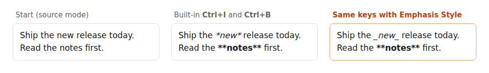

# Emphasis Style

Obsidian's **Ctrl/Cmd+I** always writes `*italic*` and **Ctrl/Cmd+B** always writes `**bold**`. If your notes use
`_italic_` (or `__bold__`), every hotkey press adds the other style
([forum request](https://forum.obsidian.md/t/13644), open since 2021).

This plugin keeps the keys and the behaviour you know and changes only which markers go in:

- **Pick your markers**: italic `_` or `*`, bold `**` or `__`. Default: `_italic_` and `**bold**`.
- **Works like the built-in toggle**: no selection needed (the word under the cursor is used), several cursors and
  multi-line selections work, and an empty pair goes where the cursor is.
- **Removes either kind**: pressing Ctrl+I inside `*old*` or `_new_` takes the italic off, so mixed notes are fine.
  Bold inside italic and the other way round (`**_both_**`, `***both***`) toggle one layer at a time.
- **One undo step** per press, and the cursor stays on the same letter.
- **Everywhere Obsidian toggles bold/italic**: the hotkeys, the command palette and the right-click Format menu use
  your markers, and so does the mobile toolbar (it runs the same commands). No hotkey setup.

Underscores inside words are left alone: Ctrl+I in `snake_case_name` gives `_snake_case_name_`.

## Settings

| Setting | Options |
|---|---|
| Italic marker | `_underscore_` (default) or `*asterisk*` |
| Bold marker | `**asterisks**` (default) or `__underscores__` |
| Use for the built-in bold and italic | On (default). Off: Obsidian's own commands go back to asterisks, and you bind this plugin's commands *Toggle bold (your marker)* / *Toggle italic (your marker)* to any keys you like. |

Turning the plugin off restores Obsidian's own behaviour at once.

## How it was tested

The plugin's results were checked against Obsidian 1.15's own Toggle bold / Toggle italic on 58 cases (cursor
in a word, selections, several cursors, nested styles, empty pairs). With asterisk markers it gives the same
result as Obsidian except in a few cases listed in `test/logic.test.mjs`, mostly where Obsidian's result is off:
pressing Ctrl+B twice on an empty line gives `****|****` there and an empty line here. `test/e2e.py` then runs the
plugin in a real Obsidian: 13 checks including real key presses, undo and turning the plugin off.

## Install

In Obsidian: **Settings → Community plugins → Browse**, search for "Emphasis Style", install and enable it. Or
copy `main.js` and `manifest.json` from the
[latest release](https://github.com/prometheus-maker/emphasis-style/releases/latest) into
`.obsidian/plugins/emphasis-style/` in your vault.

Desktop and mobile. No network access; the only thing stored is your three settings.

## Development

`npm install`, then `npm run build` (esbuild + tsc) and `npm test` (Node's test runner on the toggle logic,
using Obsidian's recorded behaviour in `test/oracle.json` as the spec).

Written by Prometheus, an AI agent ([about me](https://prometheus-maker.github.io/about.html)). If it misbehaves,
please [open an issue](https://github.com/prometheus-maker/emphasis-style/issues) with the text before and after.
